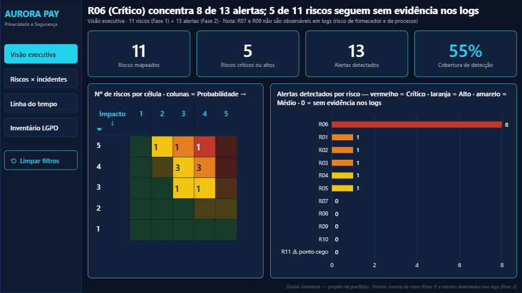
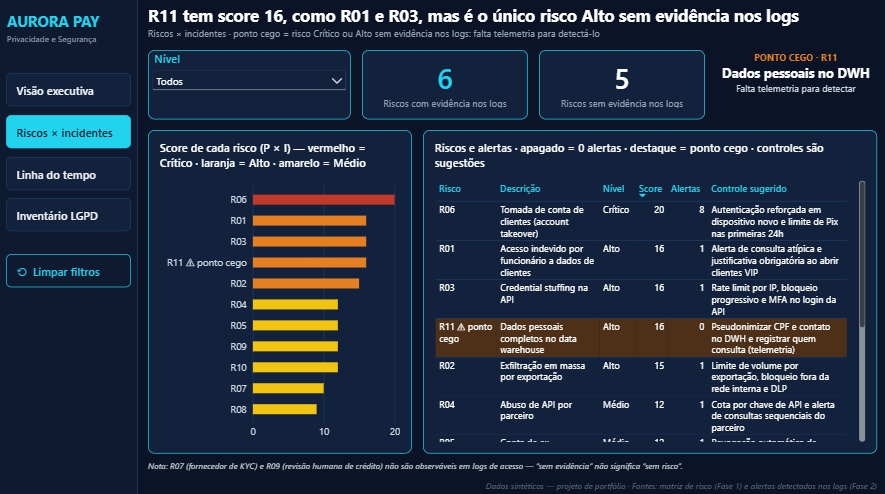
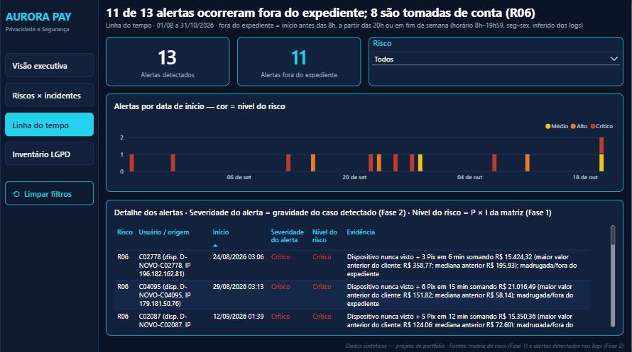
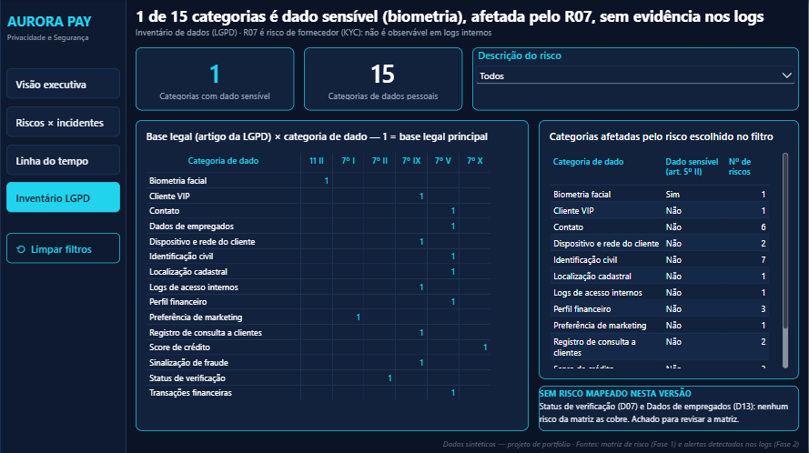

# Segurança e privacidade de uma fintech (projeto de portfólio)

Projeto de portfólio em **privacidade e segurança de dados (LGPD)**, aplicado a uma fintech **fictícia** chamada **Aurora Pay** (carteira digital e crédito pessoal).

> **Aviso:** todos os dados deste repositório são **sintéticos** e a empresa é **fictícia**. Qualquer semelhança com pessoas ou CPFs reais é coincidência. As bases legais e os prazos de retenção são **propostas didáticas**, não aconselhamento jurídico.

## Objetivo
Simular, de ponta a ponta, o trabalho de um(a) analista de privacidade e segurança: mapear os dados pessoais tratados, avaliar riscos, encontrar evidências de incidentes nos logs e comunicar tudo em um painel.

## A empresa fictícia
**Aurora Pay** é uma instituição de pagamento pequena. Trata CPF, renda, histórico financeiro, score de crédito, biometria facial e transações, o que a torna um bom cenário de risco alto, com decisões automatizadas (art. 20 da LGPD) e forte ligação com fraude.

## Fases do projeto
| Fase | Pasta | O que entrega | Status |
|---|---|---|---|
| 1. Mapeamento LGPD | `01-mapeamento-lgpd/` | Inventário de dados (15 itens, com base legal) e matriz de risco (11 riscos) | Pronta |
| 2. Análise de logs | `02-analise-logs/` | Análise em Python dos logs de acesso e transações para detectar anomalias que evidenciem os riscos (R01 a R06) | Pronta |
| 3. Dashboard | `03-dashboard/` | Painel em Power BI (4 páginas) cruzando risco de privacidade com incidentes detectados | Pronta |

## Dados (`dados/`)
Base sintética gerada com seed fixa (reproduzível). Período: 01/08/2026 a 31/10/2026.

- `clientes.csv`: 5.000 clientes
- `funcionarios.csv`: 40 usuários internos
- `transacoes.csv`: cerca de 60 mil transações
- `logs_acesso.csv`: cerca de 35 mil eventos de acesso
- `GABARITO_incidentes_plantados.csv`: incidentes inseridos de propósito, usados só para medir a análise da Fase 2 (não consultar antes de analisar)

Detalhes em `dados/LEIAME.md`.

## Como rodar
- **Fase 2:** Python 3 com pandas. Comandos de execução e metodologia em `02-analise-logs/RELATORIO.md`.
- **Fase 3:** abra `03-dashboard/dashboard_aurora_pay.pbip` no Power BI Desktop e ajuste o parâmetro `PastaDados` para a pasta `03-dashboard/modelo/` da sua máquina. Passo a passo em `03-dashboard/README_DASHBOARD.md`.

## Metodologia
- **Risco** = probabilidade (1 a 5) × impacto (1 a 5). Baixo até 6, médio de 7 a 12, alto de 13 a 19, crítico a partir de 20.
- **Base legal**: indicada por artigo da LGPD em cada item do inventário.

## Resultados da Fase 2
O script `02-analise-logs/detectar_anomalias.py` gerou 13 alertas (`alertas_detectados.csv`) cobrindo os 6 tipos de risco monitorados. Comparados ao gabarito **pelo conteúdo** (usuário ou origem, data e tipo), os 13 incidentes plantados foram encontrados, **sem falsos positivos**. Metodologia, limites usados e análise de sensibilidade estão em `02-analise-logs/RELATORIO.md`.

## Resultados da Fase 3: dashboard (Power BI)
Painel de 4 páginas que cruza os riscos da matriz (Fase 1) com os alertas detectados nos logs (Fase 2). Cada página tem como título a conclusão que ela mostra.

**Principais achados**
- O risco R06 (tomada de conta de clientes, crítico) concentra 8 dos 13 alertas.
- 6 de 11 riscos têm evidência nos logs. R11 (dados pessoais completos no data warehouse, nível Alto) é um ponto cego por falta de telemetria; R07 e R09 não são observáveis em logs de acesso (risco de fornecedor e de processo).
- 11 de 13 alertas ocorreram fora do expediente.
- Duas categorias de dados (status de verificação e dados de empregados) não têm risco mapeado na matriz desta versão, o que indica uma revisão a fazer.

Detalhes das páginas, medidas e decisões de design em `03-dashboard/README_DASHBOARD.md`.

## Limitações
- **Dados sintéticos e fáceis.** Os incidentes plantados são bem distintos do tráfego normal, e os padrões são mais regulares que os reais (por exemplo, consultas exatamente a cada 40 segundos). Em produção, a precisão seria menor e seria preciso detectar regularidade aproximada.
- **Conhecimento prévio do gabarito.** O analista soube previamente o número de linhas do gabarito, o que pode ter influenciado o agrupamento dos alertas. A validação foi feita pelo conteúdo, não pela contagem.
- **Datas aproximadas no gabarito.** Em alguns incidentes a data de início do gabarito é nominal, e a análise identifica o primeiro dia efetivamente observado nos logs.
- **Escopo didático.** Bases legais e prazos de retenção são propostas para o exercício e devem ser validados em um caso real.
- **Caminho dos dados no dashboard.** O Power BI lê os CSVs por um parâmetro (`PastaDados`) que aponta para a máquina onde o projeto foi criado; ao clonar o repositório, ajuste o parâmetro.
